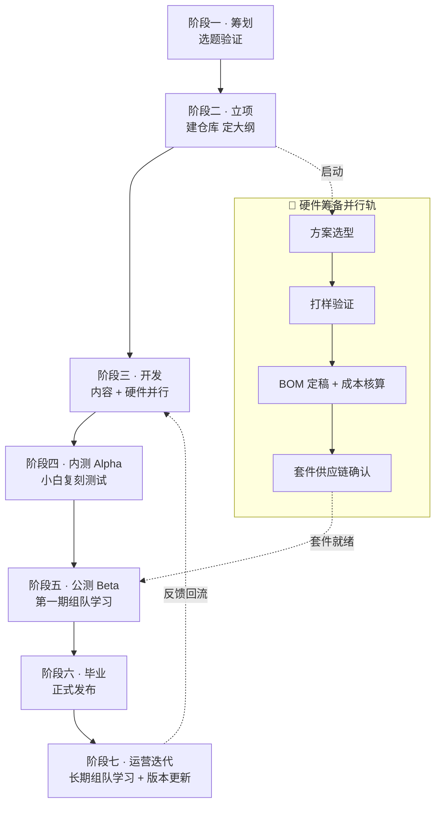
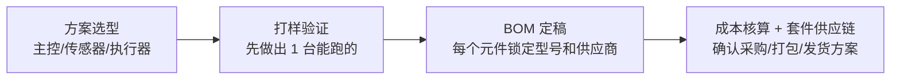
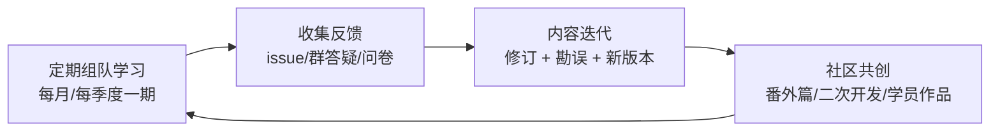

# 🛠️ 教程生产流程 SOP

> 一套 AI 硬件开源教程的完整生产流程：**筹划 → 立项 → 开发 → 内测 → 公测 → 毕业 → 运营迭代**。
> 主干对齐 Datawhale 官方 DOPMC 流程，并针对"配套实体硬件"增加了并行筹备轨和质量关卡。

---

## 🗺️ 全流程总览

**一句话看懂**：左边是内容的成长线，右边是硬件的生命线——两条线在"公测"汇合：套件必须到货，组队学习才能开营。

### 各阶段速查表

| 阶段 | 核心目标 | 关键产出物 | 过关标准 |
|---|---|---|---|
| ① 筹划 | 证明"这个教程值得做" | 立项申请表 | 三个灵魂问题都有答案 |
| ② 立项 | 把想法变成可执行的项目 | 仓库 + README 骨架 + 章节大纲 | 大纲评审通过 |
| ③ 开发 | 内容和硬件同步成型 | 全部章节初稿 + 可用套件 | 内容完成度 ≥ 80%，套件可下单 |
| ④ 内测 | 让真实小白把流程跑通 | 内测报告 + 修订版教程 | 小白独立复刻成功 |
| ⑤ 公测 | 用一期组队学习做压力测试 | 第一期组队学习结营 + 问卷 | 完课率和满意度达标 |
| ⑥ 毕业 | 以正式姿态面对公众 | 正式版 README + 发布物料 | 去掉 Beta 标，四渠道发布 |
| ⑦ 运营迭代 | 让教程持续活着、持续长大 | 周期性组队学习 + 版本日志 | 答疑响应、版本节奏常态化 |

---

## 👥 角色定义与分工映射

> 我们定义的是**职责**，不是人头。2-4 个人时一人扛多角，人多了再拆开。

### 五种职责

| 职责 | 干什么 | 关键能力 |
|---|---|---|
| 🧭 **项目负责人** | 对教程质量和进度负总责；主持立项、评审、毕业；对外接口人 | 能拍板、能催进度 |
| 🔧 **开发** | 硬件方案、代码、固件；解答技术问题 | 技术实现 |
| ✍️ **内容** | 章节撰写、配图、按风格指南打磨文字 | 把复杂讲简单 |
| 📣 **运营** | 组队学习组织、社群维护、发布宣发、问卷回收 | 活跃气氛、死磕细节 |
| 🛟 **助教** | 答疑、作业点评、陪伴学习者（可由内测优秀学员转化） | 耐心 + 热心 |

### 映射表 A：2-4 人（当前）

| 团队成员 | 兼任职责 |
|---|---|
| 成员 1 | 🧭 项目负责人 + 🔧 开发 |
| 成员 2 | 🔧 开发 + ✍️ 内容 |
| 成员 3 | ✍️ 内容 + 📣 运营 |
| 成员 4（如有） | 📣 运营 + 🛟 助教统筹 |

> 💡 助教不必专职：内测阶段学员里挑 2-3 个热心的，公测时就是现成助教。

### 映射表 B：5 人以上（未来）

一职责至少一人，助教按 **1 名助教 : 30-50 名学员** 配比扩编，项目负责人不兼开发。

---

## 阶段一 · 筹划（约 1-2 周）

> 🎯 目标：在动手之前，证明这个教程值得做。

### 要做什么

1. **回答三个灵魂问题**（写进立项申请表）：
   - **谁会学？** 画个具体的人：比如"大三大学生，玩过 Arduino 点灯，没碰过大模型，想做个能写进简历的作品"
   - **为什么是我们？** 现有教程差在哪？（参考 Datawhale 的通用痛点：内容零散 / 只教调 API / 知其然不知其所以然 / 硬件教程缺套件指引）
   - **学完能做出什么？** 一句话说清成品，最好是"能发朋友圈的那种"
2. **对标分析**：找 2-3 个最接近的现有教程（如 whale-bot），列出我们差异化在哪
3. **成本测算**：套件目标成本（参考：whale-bot 一站式套件约 300 元）、开发周期、人力

### 产出物
- ✅ 立项申请表（含：一句话定位、目标用户画像、成品描述、对标分析、成本与周期估算）

### ⚠️ 常见坑
- 选题贪大："从零手搓人形机器人"听起来酷，但新手完不成的教程等于没有教程
- 只看技术酷不酷，不看学习者能不能在 **2-4 周内看到成品**

---

## 阶段二 · 立项（约 1 周）

> 🎯 目标：把想法变成一个"骨架完整、分工明确"的项目。

### 要做什么

1. **建仓库**：复制 [README 模板](templates/README模板.md) 和 [章节模板](templates/章节模板.md) 建好教程仓库
2. **写大纲**：拆章节，每章标注三样东西——
   - 负责人 `@xxx`
   - 完成状态 `[ ]` / `[x]`
   - **"本章你能做出什么"**（如：本章结束，你的小车能听懂"前进"）
   > 📌 这就是 Datawhale 的"目录即看板"：读者看得到进度，贡献者找得到缺口。
3. **定里程碑**：倒排时间——目标公测开营日 ← 套件生产周期 ← 内测周 ← 初稿完成日
4. **启动硬件并行轨**（见下方）

### 🔩 硬件并行轨启动

- 每个元件必须回答：**"新手最容易在哪买错？"**（型号相近的元件是新手的头号噩梦）
- 预留两套方案：一站式套件（主流选择）+ 自购清单（动手党选择）

### 产出物
- ✅ 教程仓库（含 README 骨架、目录状态表）
- ✅ 章节大纲（带负责人和"本章产出"）
- ✅ 里程碑排期表 + 硬件 BOM 初稿

### ⚠️ 常见坑
- 大纲只有知识点没有人："第三章 语音原理" ❌ → "第三章 让小车听懂你的话" ✅
- 硬件打样排期乐观：**打板 + 物流翻车是常态，时间乘 1.5**

---

## 阶段三 · 开发（约 4-8 周）

> 🎯 目标：内容初稿成型，套件可以下单。

### 内容侧

1. 按 [章节模板](templates/章节模板.md) 逐章撰写，语言遵循 [风格指南](02-语言与风格指南.md)
2. **每步操作必须有图**：硬件教程的读者看不到板子就不会接（whale-bot 连"烧录前勾选哪些选项"都截了全屏图）
3. 代码逐段注释，给出**精确的版本号**（IDE 版本、库版本——版本地狱是新手第二大噩梦）
4. 每章写完自查：**"一个只按教程操作、没有任何背景知识的人，这章能走通吗？"**

### 硬件侧

1. 打样机迭代到"组装顺畅"：外壳好装吗？线够长吗？螺丝会滑丝吗？
2. BOM 锁定，套件小批量试产（建议首批 30-50 套，对应一期组队学习规模）
3. **撰写《复刻指南》**：从开箱到点亮，全程图文（这是硬件教程的"第一章"，参照 whale-bot 的"快速上手指南"）
4. 安全提示成文：电池充放电、焊接防烫、静电防护（写法见风格指南）

### 产出物
- ✅ 全部章节初稿（完成度 ≥ 80%）
- ✅ 复刻指南 + BOM 定稿 + 套件可下单
- ✅ README 完成度 ≥ 50%（达到对外展示门槛）

### ⚠️ 常见坑
- 开发自己测 = 没测。作者闭着眼睛都能跑通的流程，恰恰是小白走不通的
- 章节之间难度跳崖：每章新增知识点不超过 2 个

---

## 阶段四 · 内测 Alpha（约 2 周）

> 🎯 目标：**让 3-5 个真实小白，只用教程，把成品做出来。** 这是硬件教程最重要的一道质量关。

### 要做什么

1. **招募内测用户**：朋友圈/社群招募 3-5 人，优先选"目标画像本人"（不要全找技术好的朋友——他们测不出问题）
2. **README 加标注**：标题加【⚠️ Alpha 内测版】，首页顶部加提示块："本教程正在内测，遇到问题请直接提 issue 或进群反馈，你的每个吐槽都会让教程变好"
3. **观察并记录所有卡点**：
   - 内测者问出的每个问题 = 教程的一个缺陷，逐条登记
   - 最好能"看着做不插手"：卡 5 分钟以上才提示，这样才知道真实卡点在哪
4. **回收问卷**：哪章最难？哪里想放弃？套件满意吗？
5. **修订**：卡点清零后进入公测
6. **转化助教**：从内测学员里邀请 2-3 位热心人担任公测助教

### 产出物
- ✅ 内测报告（卡点清单 + 修订记录）
- ✅ 修订版教程 + 助教名单

### 过关标准
- 至少 3 名内测者**独立**复刻成功
- 高危卡点（涉及安全、套件缺件）清零

### ⚠️ 常见坑
- 舍不得改：内测暴露大改需求时，记住——**现在改是 5 个人的成本，公测翻车是 100 个人的口碑**

---

## 阶段五 · 公测 Beta（一期组队学习，约 3-4 周）

> 🎯 目标：用一期真实的组队学习，同时完成三件事——内容压力测试、种子用户积累、运营模式跑通。

### 要做什么

1. **标注 Beta**：README 标题换【🧪 Beta 公测版】
2. **发布招募**：写招募帖（话术见 [运营手册](03-运营手册.md)），名额建议 100-200 人，名额制本身制造稀缺感
3. **确认套件就绪**：开营前学员能买到/收到套件——**硬件没到齐，绝不开营**
4. **跑一期组队学习**（14-21 天）：开营 → 打卡 → 答疑 → 结营，完整节奏见运营手册
5. **问卷收尾**：完课率、满意度、NPS（愿不愿意推荐给朋友）
6. **沉淀 UGC**：优秀学员笔记、作品视频收集起来，毕业典礼展示 + 反哺教程

### 产出物
- ✅ 第一期组队学习结营报告（完课率、问卷数据、典型问题）
- ✅ 修订版教程（根据公测反馈）
- ✅ 学员作品集

### 过关标准（参考线）
- 完课率 ≥ 30%（组队学习行业常态 20-40%，别被吓到）
- 满意度 ≥ 4/5，且没有"因为教程错误导致做不出来"的集中投诉

---

## 阶段六 · 毕业（约 1 周）

> 🎯 目标：摘掉 Beta 标，以正式姿态面对公众。

### 要做什么

1. **全员终审**：逐章过一遍，内容作者以外的人必须参与（作者有盲区）
2. **README 定稿**：去掉【🧪 Beta】标注，补齐鸣谢名单（按贡献排序、实名 + 角色标签，参考 self-llm 的贡献者墙）
3. **定 License**：文档建议 CC BY-SA 4.0，代码建议 MIT/Apache-2.0
4. **四渠道发布**（节奏详见运营手册）：
   - GitHub：正式版 + Release v1.0
   - 官网/文档站：上线在线阅读版
   - B 站：发布教程介绍视频（1-3 分钟，晒学员作品）
   - 社群：毕业通告 + 下一期组队学习预告
5. **发版本**：打 Release（v1.0），附上 PDF 版教程

### 产出物
- ✅ 正式版教程（四渠道齐发）
- ✅ Release v1.0 + PDF
- ✅ 发布通稿

---

## 阶段七 · 运营迭代（长期）

> 🎯 目标：教程发布不是终点，是运营的起点。让它持续活着、持续长大。

### 常态化动作

| 动作 | 频率 | 负责职责 |
|---|---|---|
| 组队学习 | 每月或每季度一期 | 📣 运营 + 🛟 助教 |
| issue/群答疑 | 工作日 24h 内响应 | 🔧 开发 + 🛟 助教 |
| 版本更新（News 更新日志） | 有实质更新就发 | ✍️ 内容 |
| 章节时效自查（"内容核查至 X 年 X 月"） | 每季度 | ✍️ 内容 |
| 套件库存与供应链巡检 | 每期开营前 | 🧭 项目负责人 |
| 社区 PR 处理（番外篇/纠错） | 每周集中处理 | 🧭 项目负责人 |

### 让教程长大的三个接口

1. **纠错接口**：issue 模板区分"内容错误"和"新内容许愿"
2. **共创接口**：设 `Extra/`（番外篇）目录接收社区 PR——学员的二次开发（比如给小车加机械臂）是最好的番外素材
3. **展示接口**：定期做"学员作品展"，优秀作品进 README——这是对学员最强的激励，也是对路人最强的广告

---

## 📋 附：阶段门禁速查卡

> 打印出来贴在群里，每进一个阶段打一次勾。

- [ ] **立项了**：申请表通过、仓库建好、大纲带负责人和状态
- [ ] **能内测了**：章节初稿 ≥80%、复刻指南写完、套件可下单
- [ ] **能公测了**：≥3 名小白独立复刻成功、助教到位、套件库存够
- [ ] **能毕业了**：公测问卷达标、终审通过、鸣谢名单齐了
- [ ] **发布完了**：四渠道齐发、v1.0 已打 tag、下一期组队学习已预告
