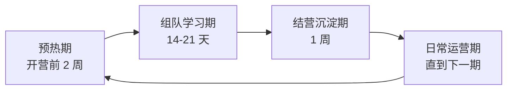
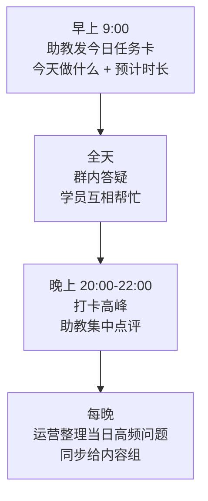

# 📣 运营手册

> 教程做得再好，没有人学、没有人晒，就是一份躺在仓库里的文档。
> 本手册把 Datawhale 验证过的"组队学习"模式，改造成适配 AI 硬件教程的运营打法。

---

## 🌊 运营总节奏

每一期组队学习 = 一次完整的小型战役：预热招人 → 陪伴学习 → 结营展示 → 沉淀迭代 → 再预热。

---

## 一、预热期（开营前 2 周）

> 🎯 目标：招满学员 + 让学员的硬件在开营前到位。

### 动作清单

| 时间 | 动作 | 负责 |
|---|---|---|
| D-14 | 发布招募帖（GitHub/公众号/社群/B站动态），开放报名 | 📣 运营 |
| D-14 | 上架套件购买通道，明确"下单截止日"（倒推物流时间） | 🧭 项目负责人 |
| D-10 | 助教就位（内测转化的助教 + 团队兼任），建助教群 | 📣 运营 |
| D-7 | 报名截止，拉学习群，发《学前须知》 | 📣 运营 |
| D-3 | 群内接龙确认"套件已到手"，未到货的单独跟进 | 🛟 助教 |
| D-1 | 发开营预告 + 第一周学习路线 | 📣 运营 |

### 📢 招募帖话术模板

> **【招募】XX 天，从零手搓一台会聊天的 AI 小车 🤖**
>
> 不吹牛，先说你能得到什么：
> - 一台自己亲手组装、能听懂你说话的 AI 小车（可以带去任何面试的那种）
> - 一套从硬件到代码的完整知识，全程有人陪、有群问
> - 一群一起折腾的小伙伴，还有可能拿到结营证书和周边
>
> 你需要什么：
> - 零基础可以！不需要会焊电路，不需要学过单片机
> - 套件一站式购齐（约 XXX 元，也可以按清单自购）
> - XX 天，每天大约 1-2 小时
>
> 本期仅 XX 个名额（助教带得过来才敢开），X 月 X 日截止报名。
> 报名入口 → [链接]

> 📌 话术要点：**先晒成果，再降门槛，最后制造稀缺**。这三板斧的顺序不能乱。

---

## 二、组队学习期（14-21 天）

> 🎯 目标：让尽可能多的人**跑完全程做出成品**。完课率是唯一的北极星指标。

### 2.1 每日节奏

### 2.2 打卡机制（Datawhale 验证过的核心引擎）

- **打卡内容**：今日进度 + 一张照片/截图（小车的、代码的、报错的都行）+ 一句话感受
- **底线规则**：打卡少于一句话、纯复制粘贴的不算（Datawhale 的标准是 50 字，可参考）
- **可选加强：监督金机制**——报名时交小额监督金（如 29 元），完成全部打卡全额退还，被"抱出群"不退。Datawhale 实测有效提升完课率，但会提高报名门槛，**第一期建议不用，第二期再上**
- **全勤奖励**：结营证书 + 名字写进教程 README 的"优秀学员"区

### 2.3 答疑 SLA

| 问题类型 | 响应时限 | 谁答 |
|---|---|---|
| 硬件故障（套件缺件/损坏） | 当天，优先处理 | 🛟 助教 → 🧭 负责人 |
| 学习卡点（报错/不会操作） | 工作时段 2 小时内 | 🛟 助教 |
| 深度技术问题 | 24 小时内 | 🔧 开发 |
| 教程内容错误 | 确认后立即修正 | ✍️ 内容 |

> 📌 **每个被问 2 次以上的问题，必须进教程 FAQ**——答疑不是成本，是内容迭代的探针。

### 2.4 关键节点活动

| 节点 | 活动 | 目的 |
|---|---|---|
| 开营日 | 开营仪式：自我介绍接龙 + 晒开箱照 | 破冰，建立"我们是一起出发的" |
| 第 3 天 | "小车第一次动起来"集体庆祝 | 第一个成就感峰值，防流失 |
| 中期 | 中期盘点：公布打卡榜 + 给掉队同学私信打气 | 挽回流失 |
| 倒数 3 天 | 预告结营典礼 + 征集作品视频 | 冲刺动员 |

---

## 三、结营沉淀期（1 周）

### 动作清单

1. **结营典礼**（线上 1 小时）：作品展示 → 优秀学员颁奖 → 助教致谢 → 下一期预告
2. **发问卷**（当天发，3 天截止）：完课率、满意度、NPS、最想吐槽的一点
3. **出结营报告**：数据 + 优秀作品 + 典型问题 → 同步内容组进入迭代
4. **沉淀 UGC**：学员笔记、作品视频整理归档，征得同意后用于宣传
5. **助教转化**：从本期优秀学员里捞下一期助教（这是模式能转起来的飞轮）

### 🏆 激励体系

| 激励 | 给谁 | 成本 |
|---|---|---|
| 结营电子证书 | 完成全部打卡者 | 零成本，仪式感拉满 |
| README"优秀学员"实名区 | 全勤 + 作品优秀者 | 零成本，最强荣誉 |
| 周边（贴纸/徽章/定制件） | 优秀作品 Top N | 小成本 |
| 积分制（参考 Datawhale 鲸币） | 贡献者：内容 PR 高分、bug 修复低分、答疑累计分 | 兑换周边 |
| 助教聘书 + 优先内测权 | 助教 | 零成本 |

---

## 四、日常运营期（两期之间）

- **社群保温**：每周 1-2 次话题（学员作品转发、新功能预告、行业趣闻），别让群死掉
- **内容迭代**：按 [SOP 阶段七](01-教程生产流程SOP.md) 的节奏处理 issue、发版本、更新 FAQ
- **学员作品展**：每月一期公众号/动态，展示学员的二次开发（小车加机械臂、改外壳涂装……）——对学员是荣誉，对路人是广告
- **社区共创引导**：把"想加功能但没时间做"的点子挂成 issue，等社区认领

---

## 五、四渠道发布节奏表

> 一个新内容（版本发布/组队学习招募/作品展）出炉后的标准动作：

| 渠道 | 内容形态 | 时机 | 要点 |
|---|---|---|---|
| **GitHub** | Release + README News 更新 | 第一时间 | 打 tag，News 区带日期和一句话亮点（学 tiny-universe："XXX 震撼发布！"） |
| **官网/文档站** | 同步章节更新 + 报名页 | 同天 | 在线阅读版永远是最新版 |
| **B 站** | 1-3 分钟视频 | 发布后 1-3 天 | 晒成品、晒学员作品，比讲知识点效果好十倍 |
| **社群** | 图文通告 | 同天 | 群内首发 + 引导转发，群友是最铁的种子传播者 |

### 渠道分工建议

- GitHub 是**家**：一切内容的源头和最终归宿
- 官网是**门面**：路人了解我们的第一窗口
- B 站是**喇叭**：拉新主战场，硬件成品的视频天然有传播力
- 社群是**客厅**：留存和转化的发生地

---

## 六、运营话术库

### 开营通知
> 🎉 开营啦！欢迎大家登上本次"手搓 AI 小车"之旅～
> 未来 XX 天，我们会一起从一堆零件开始，造出一台能听懂你说话的小车。
> 先来三件事：① 群里接龙自我介绍（称呼+坐标+一句期待）② 晒出你的套件开箱照 ③ 把群置顶
> 明早 9 点，第一份任务卡准时发。Let's go! 🚀

### 每日任务卡
> ☀️ Day X 任务卡
> 📖 今日内容：第 X 章《让小车听懂你的话》
> ⏱️ 预计用时：1-1.5 小时
> 🎯 今日成就：对小车说"前进"，它会真的跑起来
> 🛟 卡住了：先看教程附录 FAQ，还不行就在群里 @助教
> 完成记得打卡哦～

### 掉队私信
> 嗨～注意到你这两天没打卡，是卡住了还是最近忙呀？
> 卡住的话把问题丢给我，别一个人硬扛；忙的话也没关系，教程一直在，跟上大部队随时欢迎 😊

### 结营感谢
> XX 天前，大家手里还只是一堆零件；今天，XX 台小车已经在全国各地的桌面上跑起来了。
> 你们造的不只是小车，是这个教程存在的意义。谢谢大家，我们下一期见！🐳

---

## 📋 每期组队学习检查清单

- [ ] 招募帖发出，套件购买通道开启，下单截止日明确
- [ ] 助教就位（1:30-50 配比），助教群建好
- [ ] 开营前 3 天完成"套件到手"接龙确认
- [ ] 任务卡、打卡规则、FAQ 准备好
- [ ] 每日答疑 SLA 有人认领
- [ ] 结营问卷、结营典礼、结营报告排上日程
- [ ] 优秀学员 UGC 归档，助教转化完成
